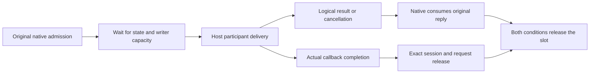

# Native file-participant transport

Current editor integration: [native file participants](NATIVE_FILE_PARTICIPANTS.md)
now negotiate this boundary and connect preflight, policy, review and ordinary
text application. The disabled-editor statements below describe the original
transport-only milestone and its evidence, not the current App behavior.

The optional host now has an opt-in native transport for create/rename/delete
participants. `Prepared::with_file_participation()` negotiates the experimental
boundary for native coordinator callers. It is exercised by real selected
extensions. **The editor does not enable it yet:** native Explorer still uses
the existing completion-event path. This transport returns contributed edits;
it does not apply them or perform filesystem operations.

The public will subscriptions exist only in a negotiated host. Default editor
sessions continue reporting them as unavailable. The committed default runtime
name inventory therefore stays at its separately audited 132/421 names.

## Admission and completion

`Client::start_file_participation` reserves one original native request identity,
deadline and operation frame. Its starting inventory must be admitted, but
documents may legitimately change while staging or while participants run.
Selected-owner lifetime flags are sealed at actual dispatch. The operation URI
frame comes from the same bounded builder as completion events. This phase
performs no filesystem work.

Dispatch follows admitted document/configuration state. Actual writer pressure
retains the original frame and identity; staging does not renew the deadline.
The host receives only the remaining callback budget. Native deadline checks
remain authoritative despite transport delay. A timely accepted reply ends that
callback budget; later review does not give the callback a renewed deadline.
Cancellation frames can drain even while ordinary mirror publication is suspended.

The host races delivery against cancellation without treating that race as actual
completion. The callback slot remains occupied until the engine's separate
settlement receipt. A synchronous callback throw after admitting a wait follows
the same rule. Duplicate live identities cannot acknowledge their original work
as unstarted. Refused or malformed requests acknowledge only work known not to
have begun; foreign cancellation cannot affect another request.

Native capacity requires both exact actual completion and reply consumption.
Either receipt may arrive first. Wrong sessions, old IDs and repeated releases
cannot release another invocation. Unsent cancellation/expiry releases only known
unstarted work. Sent timeout/cancellation retains capacity through late results
and completion. These requests use their own deadlines rather than the generic
30-second command timeout, so a held promise does not kill a responsive host.

## Values and authority

Replies preserve the complete ordered source WorkspaceEdit DTO: text, file
options and binary content, snippets, EOL, annotations and notebook rows. They
are not flattened into text edits or applied piecemeal. Native envelope checks
bound the edit to 2 MiB/4,096 rows and contributor names to the selected cohort;
the original host engine enforces its additional resource/raw-content bounds.
A separate private sideband carries the actual contributor owners and the
conversion-time IDs/versions of versioned text targets. It comes from private
native mirrors, never public document getters. Per-edit create suppression also
suppresses that target proof. This sideband does not change the public event or
WorkspaceEdit DTO. Applying backends must still validate every row and its native
target authority, especially unversioned/file/notebook rows.

Private manifest labels supply contributor names. Mutating an extension's public
`packageJSON` cannot change those labels. Invalid labels cannot leave an accepted
edit behind. Original creator leases still govern callback execution, thenable
assimilation and conversion.

The source converter reads versions after awaited delivery. Native receipt
therefore validates the returned private target IDs/versions against the actual
models at that point, without rebasing the submitted edit. Consumption then
checks those original targets again. A later edit/Undo ABA, resource change,
closed/replaced model or retired/re-enabled contributor refuses the reply.
Unrelated edits, language changes and saved-baseline changes with unchanged text
versions do not invalidate an otherwise valid result. Writable history/baseline
proofs belong to the subsequent native apply worker, not the callback's starting
document inventory. View navigation does not redirect the original URI frame.
Filesystem identity proofs, preview and apply remain separate coordinator work.

## Qualification and next integration

Ten host controls cover negotiation, full values, cancellation/late getters,
duplicate/refused work, synchronous failure, owner retirement, early timers and
invalid contributor labels, private identity spoofing and create suppression.
Nine native controls include real selected-package
delivery, exact full DTO order/version/binary values, unchanged dirty Unicode/CRLF
models and disk, held-callback cancellation with actual release, real writer
pressure, staged expiry, conversion-time versions after legitimate edits,
target/contributor ABA, stale/replaced targets, completed callback budgets and
malformed receipts/budgets. These prove the transport boundary, not editor
participation.

All 782 host tests and 1,564 Rust all-target tests pass across 67 reports
(1,215 library tests; 23 ignored cases provide no qualification). Formatting,
strict locked all-target Clippy and native build pass. The existing native
Explorer create/rename/trash terminal journey is separately rechecked against
the rebuilt executable. No local VS Code instance was launched; CI remains
deferred.

The next coordinator must connect original native operations to filesystem
preflight, configured participant enable/timeout policy, cancellation/progress,
preview/confirmation with remembered profile preference, full contributed-edit
application, original-operation continuation and public history/event ordering.
Ordered file/text/snippet/EOL/notebook groups and broader platform/package
qualification, including in-flight activation cohorts, remain part of the full
API objective.

Pinned reference: VS Code 1.141.0 commit
`2a59476c9bfcb90b3ddc372c36762471b7dfad1c`,
[main-thread cancellation and additional-edit review](https://github.com/microsoft/vscode/blob/2a59476c9bfcb90b3ddc372c36762471b7dfad1c/src/vs/workbench/api/browser/mainThreadFileSystemEventService.ts),
[participant timeout policy and error isolation](https://github.com/microsoft/vscode/blob/2a59476c9bfcb90b3ddc372c36762471b7dfad1c/src/vs/workbench/services/workingCopy/common/workingCopyFileOperationParticipant.ts),
[conversion-time document versions](https://github.com/microsoft/vscode/blob/2a59476c9bfcb90b3ddc372c36762471b7dfad1c/src/vs/workbench/api/common/extHostFileSystemEventService.ts).
